# Praxis

[](https://github.com/matteogallo-ai/praxis/actions/workflows/ci.yml)
[](LICENSE)
[](https://scorecard.dev/viewer/?uri=github.com/matteogallo-ai/praxis) ([why some checks stay low](docs/supply-chain.md#scorecard-checks-that-stay-low))

> A 7-stage LLM pipeline that turns a business question into an analytical
> briefing shaped by a declared format (executive pre-read, McKinsey-style
> note, position paper, family-office memo), with sourcing checks, an
> adversarial review and Markdown / PDF / DOCX output.

## Status: live execution under repair

Praxis has **not yet produced a briefing against a real model**. Every
recorded live run failed (5 of 5, see [`CHANGELOG.md` § 1.2.1](CHANGELOG.md)):
three aborted on the `strict` sourcing policy because the model returned
findings without source URLs, one on prose before the JSON, one on a 60 s
timeout during web search. Everything listed under [Features](#features) is
proven on the mock provider, which replays hand-written fixtures; that proves
the wiring, not the quality of a model's output.

Making the live path work, and measuring it (cost, tokens, duration, a scored
sample), is the work under [Roadmap](#roadmap).

## Architecture

Seven LLM calls in a fixed order, each stage receiving the earlier stages'
typed output. Stages run one after another; nothing runs in parallel today.

```mermaid
flowchart LR
    Q([Question + format]) --> S1[1 Scoping]
    S1 --> S2[2 Research<br/>web_search]
    S2 --> V2{{sourcing check}}
    V2 --> S3[3 Stakeholders<br/>web_search]
    S3 --> V3{{sourcing check}}
    V3 --> S4[4 Risks<br/>web_search]
    S4 --> V4{{sourcing check}}
    V4 --> S5[5 Options<br/>web_search]
    S5 --> S6[6 Synthesis<br/>one call per section,<br/>sections in parallel]
    S6 --> S7[7 Adversarial review<br/>web_search]
    S7 -- revised recommendation needed --> S6b[Synthesis rerun<br/>at most once]
    S7 --> R([Renderers<br/>md · pdf · docx])
    S6b --> R
```



| Stage | Reads | Writes |
| --- | --- | --- |
| 1 Scoping | question, format | reformulated question, sub-questions |
| 2 Research | scoping | sourced findings |
| 3 Stakeholders | scoping, research | stakeholders and positions |
| 4 Risks | scoping, research, stakeholders | risks, likelihood, impact, mitigations |
| 5 Options | stages 1–4 | 2–4 options with trade-offs |
| 6 Synthesis | stages 1–5, format sections | one text per format section |
| 7 Adversarial review | the assembled brief | critiques and whether to revise |

The sourcing check after stages 2–4 enforces the format's `sourcing_policy`:
under `strict` a missing, stale or untrusted source aborts the brief; under
`permissive` it is reported. `docs/architecture.md` has the module map.

## Quick start

Requirements: [Bun](https://bun.sh) 1.3 or later and git. Everything else,
[PromptLang](https://github.com/matteogallo-ai/promptlang) included
(`@promptlang/core`), comes from npm through the lockfile.

```bash
git clone https://github.com/matteogallo-ai/praxis.git && cd praxis && bun install --frozen-lockfile && bun run cli brief "Should we enter the German market?" --format auto --full
```

The CI job `clean-clone` runs exactly these steps, plus `bun test`, in a
directory with nothing else in it.

That runs on the mock provider: no key, no network. Its text comes from
fixtures chosen by format, so every question with the same format gets the
same briefing.

`--provider anthropic` with `ANTHROPIC_API_KEY` set calls the real API. It is
paid, and in its current state it is expected to fail (see Status).

## Features

- Briefing formats as YAML files checked against a typed schema (C01); four of them ship (C02).
- Seven stages run end to end on the mock provider; pipeline smoke test, not a quality measure (C03).
- Every stage's model output is parsed and validated into typed records; malformed output is a typed error (C04).
- Sourcing checks: explicit `SOURCE_MISSING` markers, freshness, domain trust, cross-stage duplicates, `strict` or `permissive` (C05).
- One bounded synthesis rerun when the adversarial review asks for it (C06).
- `strict_editorial` formats regenerate sections that break their rules (C07).
- Markdown, PDF and DOCX renderers (C08).
- CLI with format listing, inspection, validation and keyword-based `--format auto` (C09).
- Library entry point with a typed error hierarchy (C10).
- Anthropic provider with the server-side `web_search` tool loop and bounded retries, tested against hand-written API-shaped fixtures, not the live API (C11).
- Reproducible mock benchmark: `bun run bench:mock` twice leaves `git status` clean (C12).
- Paid live tests run only on explicit opt-in (C13).
- Handling of the three observed live failures: prose around the JSON, a degraded briefing instead of an abort under `strict` sourcing, per-stage timeouts; tested on fixtures, not live (C15).
- `brief --full` checkpoints every stage and resumes a failed run with `--resume <run-id>`; bounded retry per stage; tokens and cost per stage in `metadata.json`; `--max-cost-usd` budget cap (C16).
- Untrusted content (earlier stages' output, web page excerpts) delimited in every prompt; answers that obey an injected instruction are rejected; tested on a simulated poisoned search result, not against a live model (C17).
- The API key never reaches stderr, run files or a printed provider; home paths and e-mail addresses in stderr are masked (C20).
- Installs and runs from a clean clone, with PromptLang from npm (C19).

Each `Cnn` is a row of [`docs/CLAIMS.md`](docs/CLAIMS.md) naming the tests that
prove it; CI fails if one of them does not pass.

## Roadmap

- Live briefings that complete against Anthropic, with committed run artefacts (C14).
- Live-output quality scored by a judge validated against human labels (C18).
- Source freshness judged on each page's own age (`page_age`) (C21).
- Web search with dynamic filtering (`web_search_20260209`), evaluated against the basic tool (C22).
- The judge's noise band and planted-error detection; today each briefing is judged once (C23).

## Formats

| id | intent | length |
| --- | --- | --- |
| `executive-pre-read` | Board / executive decision, 6 sections | ~800 words |
| `mckinsey-style-note` | Situation / Complication / Answer / So-What | ~1200 words |
| `position-paper-corporate` | Public position on a regulatory or policy question | ~1500 words |
| `family-office-memo` | Patrimonial memo, `strict_editorial` | ~1200 words |

A format is one YAML file under `formats/`; see
[`docs/creating-a-format.md`](docs/creating-a-format.md).

## As a library

```ts
import { FormatRegistry, MockLLMProvider, Orchestrator } from "praxis";

const registry = new FormatRegistry();
registry.loadDirectory("formats");
const orch = new Orchestrator(
  registry,
  new MockLLMProvider({ fixturesDir: "tests/fixtures/mock-llm" })
);
const out = await orch.briefWithCritiqueAndRerun(
  "Should we enter the German market?",
  "executive-pre-read"
);
console.log(out.synthesis.total_word_count, out.rerun_performed);
```

Reference: [`docs/api.md`](docs/api.md).

## Development

```bash
bun install --frozen-lockfile
bun run typecheck                    # tsc --noEmit, strict
bun test                             # mock provider only; live tests need PRAXIS_LIVE_TESTS=1
bun run lint                         # Biome
bun run knip                         # unused files, exports, dependencies
bun run check:claims                 # docs/CLAIMS.md ≡ passing tests ≡ this README
bun run check:stale-narrative        # no future tense or untracked TODOs in shipped text
bun run bench:mock                   # renderer smoke test, writes benchmarks/outputs/mock/
```

`CLAUDE.md` lists every command, including the paid ones. The `.claude/`
directory holds the Claude Code permission settings used to build this repo:
reads, tests, `bun run *` and commits are allowed without a prompt;
`git push`, `git tag`, `curl`, `wget`, `rm -rf` and `npm install` are denied,
and so are the paid entry points: `bun run bench` and `bun run bench:live`,
every `bun run score*` script (including the free `score:dry`), and any
command starting with `PRAXIS_LIVE_TESTS=1`. `bun run bench:mock` stays
allowed. The deny rules match command prefixes, so they are a backstop, not
a guarantee: the approval rule in `CLAUDE.md` still applies to every paid run.

## How this was built

Praxis was written with [Claude Code](https://claude.com/claude-code) between
14 and 20 August 2026, v0.1 to v1.3.0 in about 135 commits. Each release
started from a written spec; the agent wrote the code, the tests and the
fixtures.

What went wrong is instructive:

- **The tests could only prove wiring.** Every agent was developed against a
  mock provider that returns hand-written, perfectly formed JSON with four
  verified sources per finding. A real model does not behave like that, and
  the first live benchmark aborted on all five briefings (Status above).
- **The benchmark measured the fixtures.** The published "AI-assisted
  scoring" graded mock briefings whose text does not depend on the question;
  a follow-up release rewrote fixtures by hand and planned to re-score them.
  Those scores are withdrawn ([`benchmarks/RESULTS.md`](benchmarks/RESULTS.md)).
- **The project was declared feature-complete without a live briefing,**
  and the README claimed it "runs live against Anthropic".

An independent audit on 2 November 2026 found the above, plus: no CI; a
quickstart that fails on a fresh clone (it omitted the sibling PromptLang
checkout); every stage sending its system prompt concatenated into
the user message; and the `@model` declared in each `.prompt` file never
reaching the API. This README, `docs/CLAIMS.md`, the CI workflow and
[`docs/ENGINEERING_STANDARDS.md`](docs/ENGINEERING_STANDARDS.md) are the first
response; the fixes to the pipeline itself are listed under Roadmap.
The design decisions, and what I would do differently, are in
[`docs/adr/`](docs/adr/README.md).

## FAQ

**Why `pdfkit`?** Writing PDF font embedding by hand would triple the renderer
for no gain. The DOCX renderer writes its Open Packaging parts by hand with
`node:zlib`.

**Can I use another model provider?** Implement `LLMProvider` (`complete`, and
`completeWithTools` for the web-search stages) and pass it to the
`Orchestrator`. See [`docs/cookbook.md`](docs/cookbook.md) § 2.

## License, contact

MIT, see [`LICENSE`](LICENSE). Maintainer: Matteo Gallo —
matteogallo.office@gmail.com. Bugs and requests via GitHub Issues; security
reports as described in [`SECURITY.md`](SECURITY.md).
